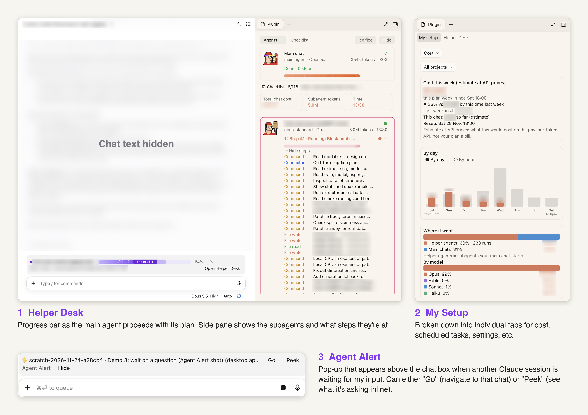

# claude-mods

Three mods for Claude Code. A mod is a plugin made of Claude Code function hooks. Mods draw in the terminal and in the Claude desktop app's Code tab, and need Claude Code 2.1.294 or later.

- [helper-desk](helper-desk/): a progress bar above the prompt for Claude's plan, and a side pane with one live card per running subagent.
- [agent-alert](agent-alert/): a line above the prompt when another Claude Code session on this computer waits for you, with Go and Peek buttons.
- [setup-pane](setup-pane/): a "My setup" side pane with your cost this plan week, scheduled tasks, agents, plugins, MCP servers, hooks and settings.

## Install

Replace `<mod>` with `helper-desk`, `agent-alert` or `setup-pane`.

In the Claude Code prompt:

    /plugin install <mod> --marketplace Alexc09/claude-mods

From a shell:

    claude plugin install <mod> --marketplace Alexc09/claude-mods

In the Claude desktop app: click + next to the prompt box, then Plugins. Choose Add marketplace and enter `Alexc09/claude-mods`, then Add plugin.

## License

Each mod is MIT licensed; see the LICENSE file in its folder. agent-alert is based on agent-standup by Double Geste (MIT). These mods are unofficial and not affiliated with Anthropic.
