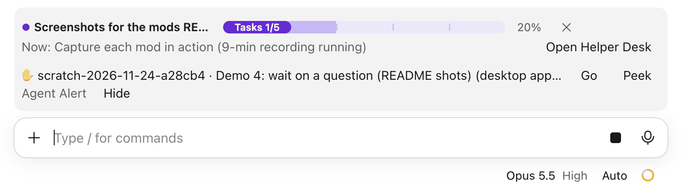

# Agent Alert

Adapted from agent-standup by Double Geste (MIT): https://github.com/Atoll92/agent-standup.

A line above your Claude Code prompt when another Claude Code session on this computer needs you, and a short toast when one starts waiting for you, or finishes its turn.

A desktop-app chat that ends its turn with a question in the app's next-step box (the box with buttons under the reply) waits for you too: it gets an "asks" row and the toast "✋ <name> asks: <question>" instead of "finished". The row goes when that chat is busy again, or a message of yours comes after the question. The band lists only the sessions waiting for you: one that finishes its turn gets the toast and no row, and when nothing waits, the band is not drawn. You stay in the session you are working in, and still know when another one is stuck on a question or an approval.

**Go** shows on the rows of sessions running in the Claude desktop app. Pressing it opens that chat in the desktop app, with the app's continue link, which opens any chat, finished or idle ones included:

    claude://code/continue?session=local_<uuid>&source=desktop_action

It runs macOS `open` with that link. The id comes from the session's status file (`hostSessionId`) and is used only when it has the shape `local_<uuid>`. Sessions in a terminal have no such id, so their rows have no Go button. If `open` fails, a toast says why.

It is a mod: a plugin of Claude Code's function hooks. It draws in the terminal and in the Claude desktop app's Code tab.

## Requirements

Claude Code 2.1.294 or later (earlier versions do not run mods). Go needs macOS and the Claude desktop app.

## Install

In the Claude Code prompt:

    /plugin install agent-alert --marketplace Alexc09/claude-mods

From a shell:

    claude plugin install agent-alert --marketplace Alexc09/claude-mods

In the Claude desktop app: click + next to the prompt box, then Plugins. Choose Add marketplace and enter `Alexc09/claude-mods`, then Add plugin and pick agent-alert.

## What it reads and runs

- Every 4 seconds, the status file Claude Code keeps for each open session, in `~/.claude/sessions/<pid>.json` (or under `CLAUDE_CONFIG_DIR`): which session, its folder, whether it is busy, idle or waiting for you, and, for a desktop-app session, the app's id for its chat. Not the conversations. A session started by a program with `claude -p` is left out: its questions go to that program. An Agent SDK app (Zed, a home-made app) is kept, since it may show its menus to a person.
- The end of a chat's conversation (the last 2 MB of `~/.claude/projects/<folder>/<session id>.jsonl`), read only when that chat finishes a turn (busy to idle) and once at startup for each idle chat, to find a next-step question it ended its turn with (its last turn's `mcp__ccd_turn__wrap_up` call with an `ask`). What it finds is kept until that chat's status changes; it is not read every 4 seconds. Peek reads the same end of the conversation while its pane is open. It never reads this session's own.
- `ps`, to check that a session said to be waiting still runs: a session that crashed leaves its file behind.
- `open claude://code/continue?...`, only when you press Go.

It writes nothing and sends nothing anywhere.

## Credits

Original: agent-standup by Double Geste, https://github.com/Atoll92/agent-standup. Unofficial: not affiliated with or endorsed by Anthropic. MIT licensed (see LICENSE).
