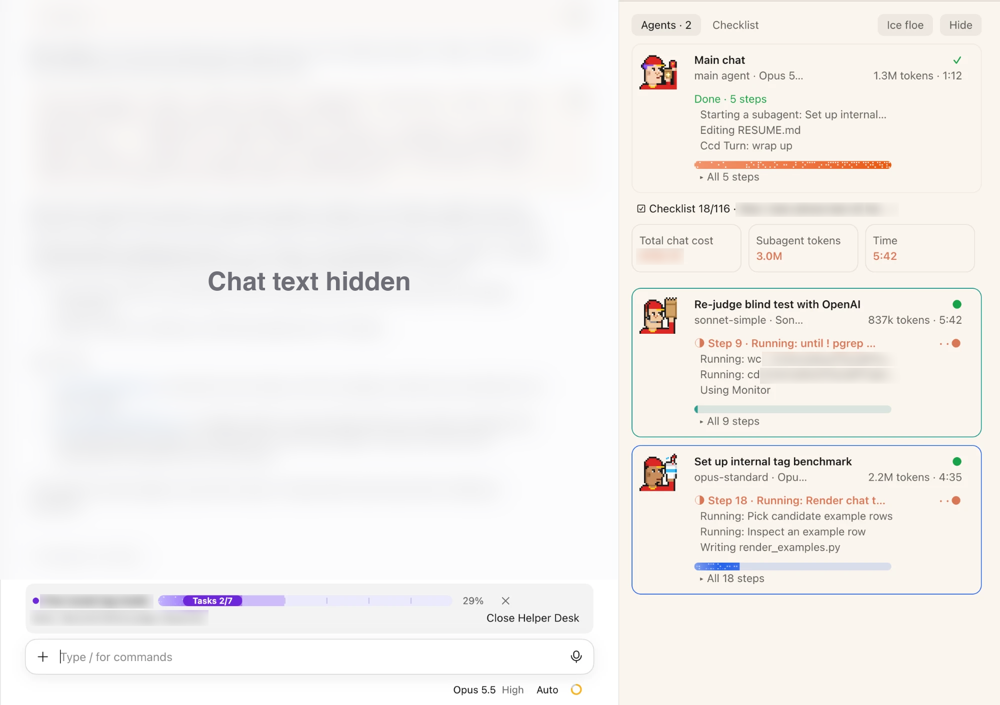
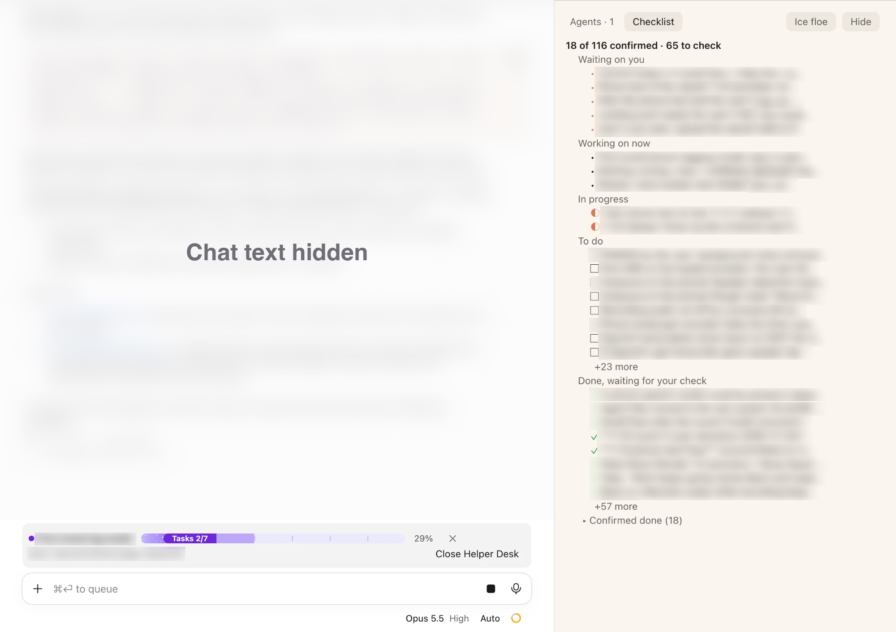

# Helper Desk

Helper Desk draws a purple progress bar above the Claude Code prompt that moves as Claude finishes each step of its plan. It also adds a side pane with one live card per running subagent: what it is doing now, its last few steps, its tokens and time. The pane can also show the project's checklist from `TODO.md` or `RESUME.md`.

| Agents | Checklist |
|---|---|
|  |  |

Chat text, costs, paths and project names are blurred in these pictures.

It is a mod: a plugin made of Claude Code function hooks. It draws in the terminal and in the Claude desktop app's Code tab. The pixel mascots and the Ice floe view are described in [mascots/README.md](mascots/README.md).

## What it reads and writes

- This session's own events: tool calls, subagent starts and ends, model requests and token counts.
- `TODO.md` and `RESUME.md` in the session's folder, or the nearest folder above it, up to the git root or your home folder. Read only, every 3 seconds.
- `~/.claude/mods/switches.json`: `"helper-desk": false` turns the mod off, `"helper-desk:hidden": true` hides it. The Hide button writes this key.
- It saves each chat's plan in `~/.claude/mods-state/plan-<session id>.json`, so a reload keeps it, and writes errors to `~/.claude/mods-logs/helper-desk.log`.
- It registers a `plan` tool, adds a short section to the system prompt that asks Claude to use it, and adds a one-line reminder to a tool result when the plan has not been updated.

It sends nothing over the network.

## Commands

`/helpers` opens the pane. `/mascot`, `/crew` and `/desk` change the pictures and the view.

## Requirements

Claude Code 2.1.294 or later (earlier versions do not run mods).

## Install

In the Claude Code prompt:

    /plugin install helper-desk --marketplace Alexc09/claude-mods

From a shell:

    claude plugin install helper-desk --marketplace Alexc09/claude-mods

In the Claude desktop app: click + next to the prompt box, then Plugins. Choose Add marketplace and enter `Alexc09/claude-mods`, then Add plugin and pick helper-desk.

## License

MIT. See [LICENSE](LICENSE).
