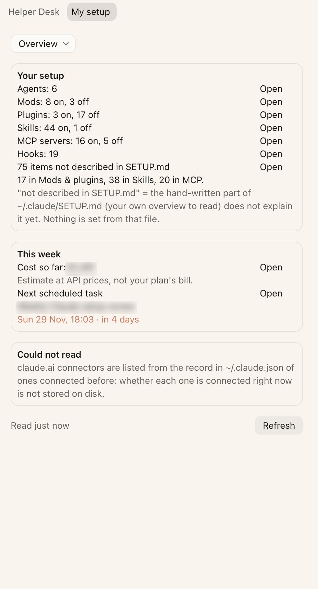
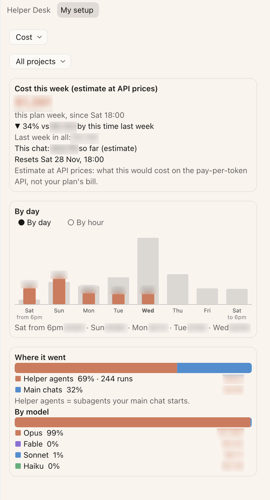
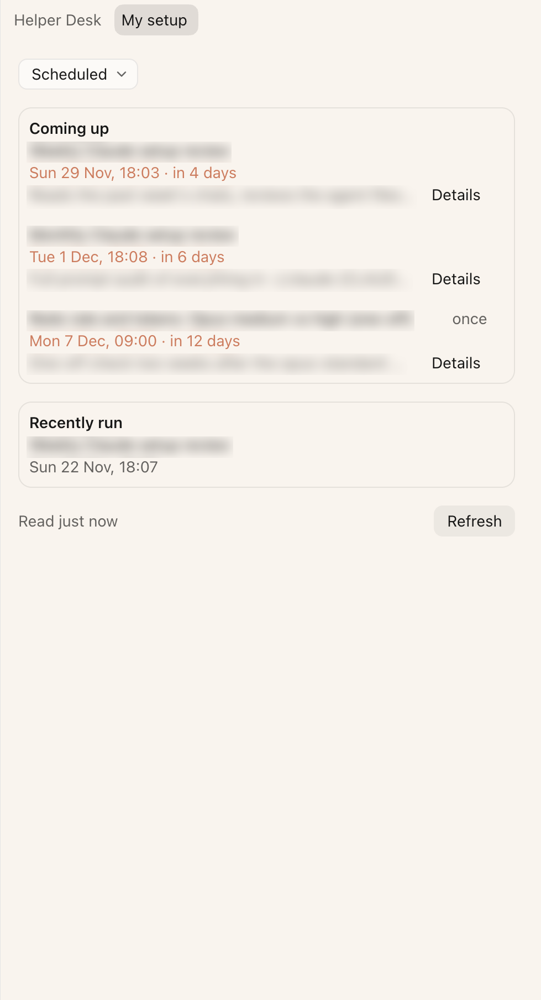
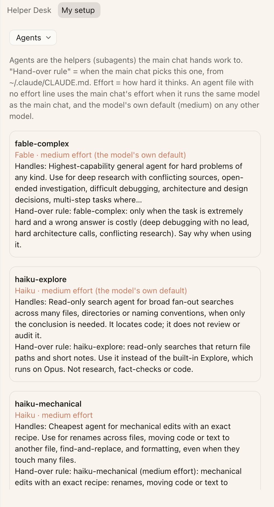
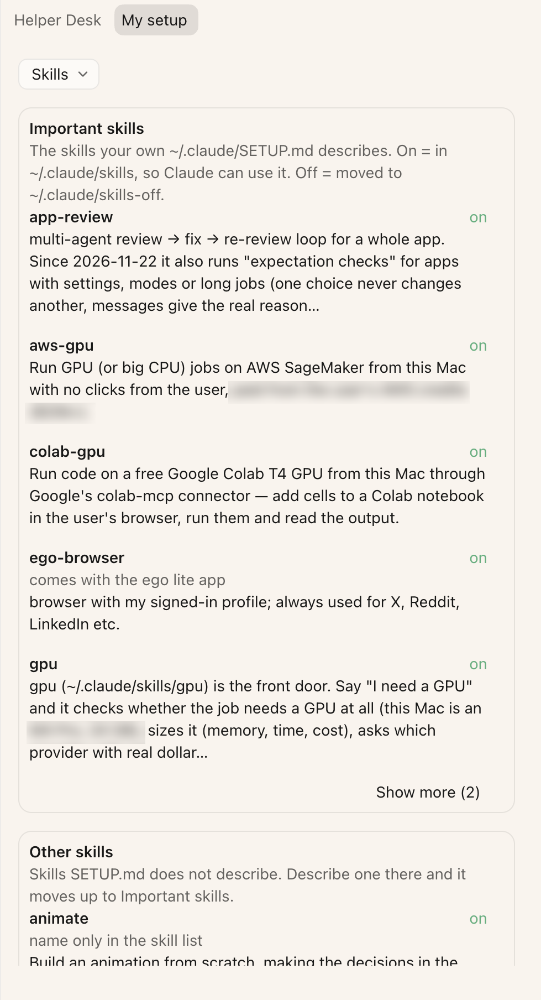
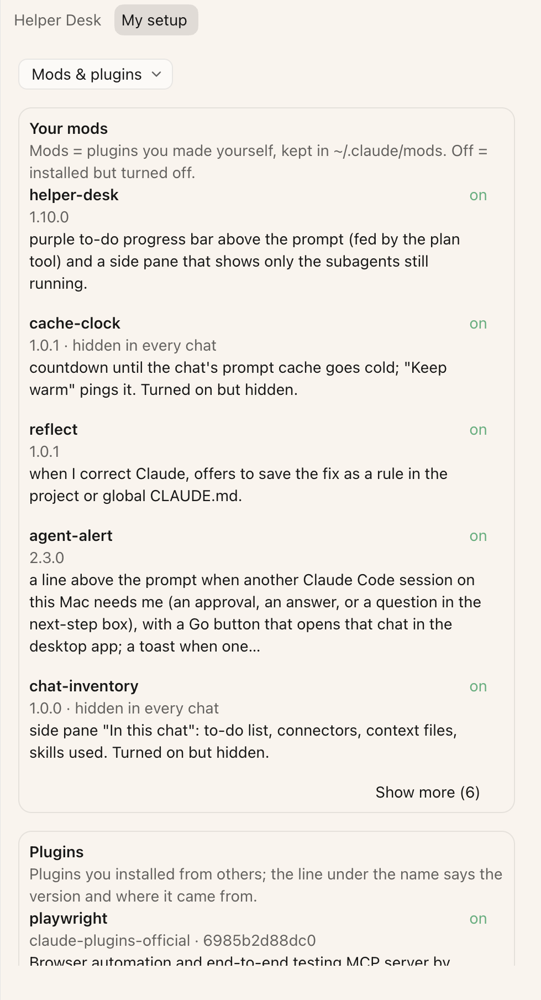
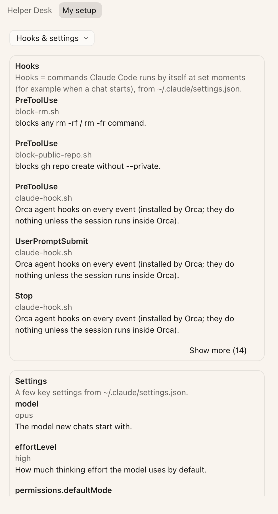

# Setup Pane

Setup Pane adds a side pane, My setup, that shows your Claude Code setup in one place. Its tabs are Overview, Cost, Scheduled, Agents, Skills, Mods & plugins, MCP, and Hooks & settings. The Cost tab estimates what this plan week cost at API prices, by day, hour, model, task and subagent.

It is a mod: a plugin made of Claude Code function hooks. Open it with `/my-setup`.

## Screens

Pick a tab from the dropdown at the top of the pane. Figures and task names are blurred in these pictures.

| Overview | Cost |
|---|---|
|  |  |

Scheduled, Agents, Skills, Mods & plugins, Hooks & settings

| Scheduled | Agents |
|---|---|
|  |  |

| Skills | Mods & plugins |
|---|---|
|  |  |

| Hooks & settings |
|---|
|  |

## What it reads and writes

- `scan.py` (Cost tab) reads the chat logs in `~/.claude/projects`. It keeps a cache in the plugin's data folder, with only short excerpts of your typed messages, with anything that looks like a key hidden.
- `inventory.py` (setup tabs) reads `~/.claude/settings.json`, `~/.claude.json`, `~/.claude/agents`, `~/.claude/skills`, installed plugins, MCP server lists and the Claude desktop app's scheduled-tasks files. It never shows env values, prompts, full hook commands or MCP URLs.
- The Scheduled tab also asks the desktop app's local `scheduled-tasks` tool for its task list.
- If you keep a `~/.claude/SETUP.md`, `inventory.py` rewrites one marked section at its end (between `<!-- auto-inventory:start -->` and `<!-- auto-inventory:end -->`). It does not create the file.

It sends nothing over the network.

## Settings in the code

- `scan.py`: `RESET_WEEKDAY` and `RESET_HOUR_UTC` set when your plan week starts (default Saturday 10:00 UTC). `DISPLAY_UTC_OFFSET_HOURS` sets the time zone (default: this computer's).
- `inventory.py`: `MY_MODS` is the name of a local marketplace of your own mods in `~/.claude/mods`, shown in its own card. `RULE_HEADING` (default `Agents`) is a heading in your `~/.claude/CLAUDE.md` whose bullets say when to use each agent.
- Prices per model are in `scan.py` (`PRICES`). Check them against the official pricing page.

## Requirements

- Claude Code 2.1.294 or later (earlier versions do not run mods).
- `python3` on your PATH (standard library only).
- macOS or Linux. The Scheduled tab reads the Claude desktop app's files, which are on macOS.

## Install

In the Claude Code prompt:

    /plugin install setup-pane --marketplace Alexc09/claude-mods

From a shell:

    claude plugin install setup-pane --marketplace Alexc09/claude-mods

In the Claude desktop app: click + next to the prompt box, then Plugins. Choose Add marketplace and enter `Alexc09/claude-mods`, then Add plugin and pick setup-pane.

## License

MIT. See [LICENSE](LICENSE).
